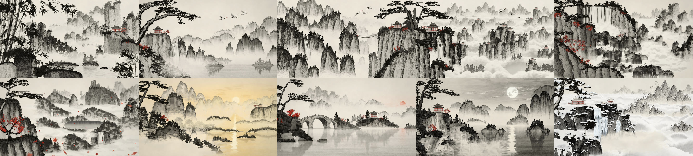

# Shanshui

Ten Chinese ink-wash landscapes (*shan shui*, "mountains and water"), painted and animated entirely in code, cut into a one-minute film.



No images, textures, fonts or audio samples are loaded anywhere. Every pine needle, cliff, mist bank, crane, ripple, snowflake and the closing seal are generated at runtime with WebGL2 shaders and Canvas2D brushwork. The soundtrack (guzheng, xiao flute, singing bowl, wind and water) is synthesized sample by sample in JavaScript.

The film is attached to the [releases](../../releases).

## The film

One minute, ten paintings, one clock: 80 BPM, two bars per painting, every seam centred on a bar line.

| | painting | arrives by |
|---|---|---|
| 0:00 | bamboo valley | painting itself in from bare paper, darkest ink first |
| 0:06 | cranes over the falls | a bank of valley mist |
| 0:12 | rope bridges | mist sweeping through the peaks |
| 0:18 | floating peaks | the camera rising through a cloud bank |
| 0:24 | red cascade | a push through waterfall spray |
| 0:30 | autumn ruins | a gust of maple leaves |
| 0:36 | golden river | the scroll unrolling, joined by mist |
| 0:42 | stone bridge, red sun | the gold sun sliding onto the red one |
| 0:48 | moon over the lake | night soaking down through wet paper |
| 0:54 | snow temple | snow thickening over the lake |
| 0:57 | | the seal is pressed; the painting evaporates back to paper |

## Watch it live

```bash
npm install
npm run serve
```

Open the printed URL: the film plays in real time in the browser (`?scene=s03` shows one painting, `?scale=1` renders at full 1080p). Space pauses, arrow keys jump between paintings, M plays the soundtrack once you have generated it.

## Render it

```bash
node tools/audio.mjs                                                    # soundtrack -> out/audio/soundtrack.wav
node tools/render.mjs --out out/shanshui.mp4 --audio out/audio/soundtrack.wav --samples 2
```

Frames are rendered by headless Chrome on the GPU, converted to YUV 4:2:0 in a shader and streamed straight into ffmpeg (x264, BT.709); nothing but the final MP4 touches the disk. Needs Node 20+, Chrome or Edge, and ffmpeg on the PATH.

## How it is built

```
src/engine/       WebGL2 compositor: parallax cards on a 2.5D camera, bakes, reflections, wind sway, grading, YUV readback
src/lib/          the painter's vocabulary: brush strokes and ink effects, pines, rocks, peaks, mist and clouds,
                  water and waterfalls, architecture, cranes, falling leaves and snow, bamboo and maples, the seal
src/scenes/       the ten paintings, each with its own helpers
src/transitions/  the seams between paintings
src/timeline.js   one clock for picture and sound
src/film.js       shot list, transitions, overlays, sub-frame motion blur
src/lab/          small scenes that show single elements of the library
tools/            stills and comparisons, contact sheets, a warm render daemon, the film renderer, the soundtrack, frame forensics
docs/             ENGINE.md (API), STYLE.md (palette and painting rules), FILM.md (the cut), LIBRARY.md (element index)
```

Each painting is a back-to-front stack of layers placed at depths in front of one camera, so slow camera moves give real parallax between foreground pines, midground peaks and far ranges. Static brushwork is baked once into textures and passed through an ink pass that pools pigment at the edges and lets it granulate into the paper. Mist, clouds, water, waterfalls, snow, cranes and falling leaves are drawn every frame as pure functions of time, so any frame renders on its own, deterministically.

The paintings were built by matching each one, region by region, against a reference painting; the reference images are not part of this repository, so the comparison options of `tools/still.mjs` (`--compare`, `--side`, `--crop`) need your own images in `ref/01.webp` ... `ref/10.webp`.

## License

MIT
